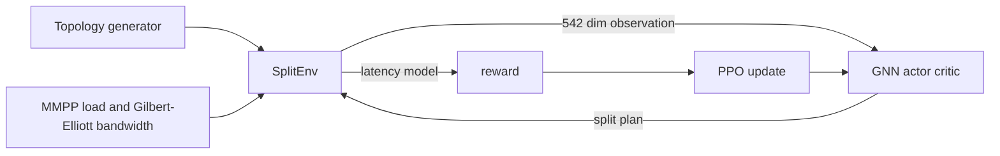

# GReMS

**Graph-Reinforced Neural Micro-Splitting over Dynamic Heterogeneous IoT Networks**

GReMS is a PPO based reinforcement learning agent that optimises split inference of VGG-16 over wireless networks of heterogeneous IoT and edge devices.
For each inference request the agent decides:

- **where** to cut the network into sequential pipeline stages (vertical split),
- **how many workers** run each stage in parallel (horizontal split),
- **which node** is the hub that distributes the input and routes data,
- **which physical node** takes each worker role.

The objective is low end to end latency under changing node load and link bandwidth.
One trained policy covers topologies with 3 to 20 nodes, including sizes never seen during training.
GReMS is compared with the DiSNet, MoDNN and EnSplit baselines.

## Where to start

| You want to | Read |
|-------------|------|
| Install and run something in minutes | [Installation](installation.md), [Quick start](quickstart.md) |
| Reproduce the paper numbers or audit them | [Reproducibility guide](reproducibility.md) |
| Understand the problem and the agent | [Problem and environment](method/problem.md), [The agent](method/agent.md) |
| Find a file or a hyperparameter | [Code structure](code_structure.md), [Configuration reference](configuration.md) |
| Build on top of GReMS | [Extending GReMS](extending.md) |
| Fix an error | [Troubleshooting](troubleshooting.md) |

## Project at a glance

The environment samples a network, advances the channel state, asks the agent for a split plan, estimates the resulting latency with an analytical model calibrated on a Jetson Nano and returns `-5 * log(latency_ms)` plus shaped penalties as reward.
