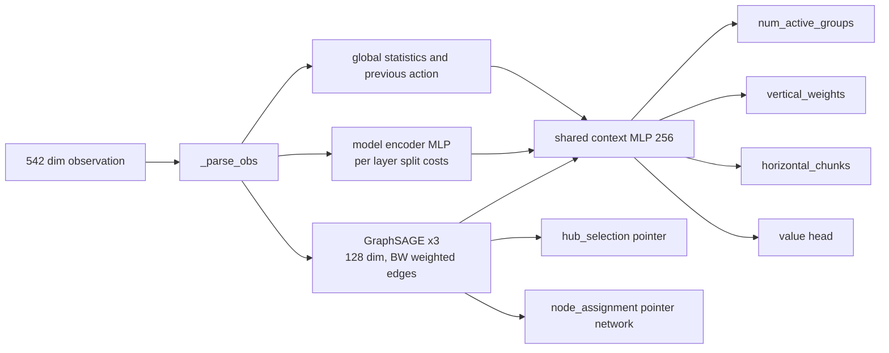

# The agent

The policy is a graph neural network actor critic, implemented in `gnn_model.py` (`GNNActorCritic`, about 428k parameters).

## Architecture

- **GraphSAGE backbone.** Three layers over the physical network graph with bandwidth weighted edges. Output: one embedding per node and a mean pooled graph embedding.
- **Model encoder.** An MLP over per layer features (activation size, cumulative FLOPs) of the 21 VGG-16 layers.
- **Shared context.** Fuses global statistics, the graph embedding, the model embedding and the previous action into a 256 dimensional vector.
- **Padding and masking.** The observation always has the same size. Topologies with fewer than 20 nodes are zero padded and the padded nodes receive a logit of minus infinity, so the agent can never choose a ghost node. This is what lets one network serve every size from 3 to 20.

## Action heads

| Head | Output | Controls |
|------|--------|----------|
| `num_active_groups` | categorical, 1 to 6 | number of vertical stages |
| `vertical_weights` | 6 categoricals with 8 bins | relative number of layers per stage |
| `horizontal_chunks` | 6 categoricals, up to 20 bins | parallel workers per stage |
| `hub_selection` | per node score | hub node |
| `node_assignment` | pointer network over 6 x 20 slots | physical node for each worker slot |

`action_space.py` decodes the raw integers into a plan with keys `group_sizes`, `chunks`, `hub_node` and `assignment`. The decoder guarantees by construction that workers of the first group are distinct and adjacent to the hub, so connectivity cannot be violated by those workers.

## Observation (542 dimensions)

Built by `state_encoder.encode_state`. Blocks 1 to 5 are aggregate statistics and independent of network size. Blocks 6 to 9 are zero padded to 20 nodes.

| Block | Dims | Content |
|-------|------|---------|
| 1 node stats | 16 | mean, std, min, max of compute, load, effective capacity, degree |
| 2 link stats | 8 | mean, std, min, max of bandwidth and latency |
| 3 topology meta | 5 | normalised node count, edge density, degree statistics |
| 4 model features | 12 | cumulative FLOPs and maximum activation per group |
| 5 topology structure | 15 | clustering, assortativity, path lengths, algebraic connectivity |
| 6 per node features | 80 | compute, load, effective capacity, degree for 20 nodes |
| 7 path and hub | 40 | path flag and hub score for 20 nodes |
| 8 layer split costs | 42 | normalised activation size and cumulative FLOP fraction for 21 layers |
| 9 bottleneck bandwidth | 190 | pairwise minimum path bandwidth, upper triangle of a 20 x 20 matrix |
| 10 previous action | 134 | normalised previous action vector |

The agent observes the true current channel state (loads and effective bandwidths).
