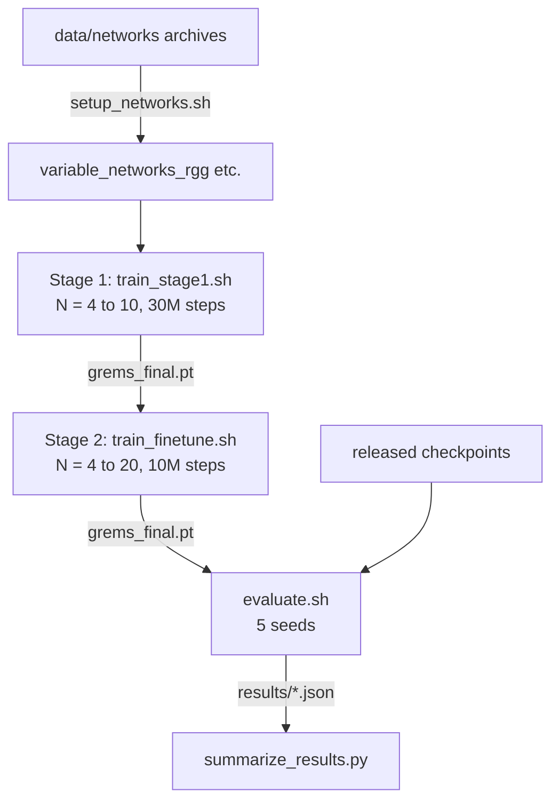

# Reproducibility guide

## Overview of the pipeline



You can enter the pipeline at any point.
Evaluating the released checkpoints (Level 1) is the fastest way to audit the reported numbers.
Re-training (Level 2) checks that the training recipe produces an equivalent policy.

| Level | What you reproduce | Hardware | Wall clock |
|-------|--------------------|----------|-----------|
| 0. Smoke test | The code runs end to end | CPU | minutes |
| 1. Evaluation | Latency tables from the released checkpoints | CPU, 8+ cores | hours |
| 2. Training | The checkpoints themselves | 1 GPU (16 GB used for the release) | about 2 days for Stage 1, about 16 hours for Stage 2 |
| 3. Extra experiments | EnSplit baseline retraining, other topology families | CPU | hours |

## Step 0. The settings that matter

The defaults in `config.py` are the settings of every reported result, so no environment variables are needed for the main experiments.
The two training stages differ only in the values below, which `scripts/train_stage1.sh` and `scripts/train_finetune.sh` set for you.

| Setting | Value |
|---------|-------|
| Link chain, P(GOOD to BAD) / P(BAD to GOOD) | 0.15 / 0.40 |
| Bandwidth factor in BAD / GOOD state | 0.15 to 0.25 / 0.80 to 1.00 of base |
| Compute load (MMPP) | LOW 0.10 to 0.35, HIGH 0.55 to 0.80, P(LOW to HIGH) = 0.05, P(HIGH to LOW) = 0.20 |
| `NODE_UTIL_BONUS` | 0.0 |
| Reward scale `ALPHA` | 5 |
| `VARIABLE_TRAIN_SIZES` | Stage 1: 4 to 10, Stage 2: 4 to 20 (set by the scripts) |
| `CONN_PENALTY_START` | Stage 1: 5.0 (default), Stage 2: 50.0 (set by the script) |

If you change any of these in `config.py` or through an environment variable of the same name, you are no longer reproducing the paper.
The full list of knobs is in the [Configuration reference](configuration.md).

## Step 1. Environment and data

```bash
pip install -r requirements.txt
bash scripts/setup_networks.sh
```

The archives contain, per topology family, 50 training and 10 test networks for every size from 3 to 20 nodes.
Test networks are the files named `varnet_<N>nodes_test_<i>.txt`.
Training never sees them.

## Step 2. Level 1: evaluate the released checkpoints

```bash
# GReMS only, 5 seeds, all sizes (3 to 20), RGG topologies
bash scripts/evaluate.sh

# Same, but also run DiSNet, MoDNN and EnSplit on identical channel states
BASELINES=1 bash scripts/evaluate.sh

# Other topology families (generalisation, the model never trained on them)
bash scripts/evaluate.sh checkpoints/checkpoints/variable_networks_GReMS_Final_Finetune/grems_final.pt ws
bash scripts/evaluate.sh checkpoints/checkpoints/variable_networks_GReMS_Final_Finetune/grems_final.pt er
bash scripts/evaluate.sh checkpoints/checkpoints/variable_networks_GReMS_Final_Finetune/grems_final.pt ba

# Aggregate the 5 seeds
python scripts/summarize_results.py results/GReMS_Final_Finetune_rgg*.json
```

The evaluation protocol is fixed in the script:

- 10 held out networks per node count, node counts 3 to 20,
- 10 independent trajectories per network, 50 steps each,
- at every step the compute load (MMPP) and every link (Gilbert-Elliott) advance, and all methods are evaluated on the **same** state,
- seeds 0, 100, 200, 300, 400,
- reported number per node count: mean latency over networks, then mean and standard deviation over seeds.

Use `--num-sequences`, `--num-steps` and `SEEDS` only for quick checks. Changing them changes the numbers.

To evaluate the Stage 1 checkpoint instead:

```bash
bash scripts/evaluate.sh checkpoints/checkpoints/variable_networks_GReMS_FINAL/grems_final.pt rgg GReMS_FINAL
```

### What to expect

### Reference numbers from the authors' runs

Mean latency in ms of GReMS (fine tuned model, RGG test networks), mean ± std over the 5 seeds 0, 100, 200, 300, 400.
These come from the authors' own earlier evaluation runs (GReMS only, `--no-baselines`) and were not re-run when this documentation was written.
A full re-run takes hours, so treat the table as an orientation, and expect small deviations from hardware and library versions.

| N | GReMS (ms) | N | GReMS (ms) | N | GReMS (ms) |
|---|-----------|---|-----------|---|-----------|
| 3 | 3950 ± 89 | 9 | 2730 ± 52 | 15 | 2492 ± 49 |
| 4 | 3130 ± 77 | 10 | 2416 ± 45 | 16 | 2440 ± 22 |
| 5 | 3088 ± 103 | 11 | 2523 ± 20 | 17 | 2452 ± 59 |
| 6 | 2804 ± 49 | 12 | 2485 ± 41 | 18 | 2534 ± 32 |
| 7 | 3154 ± 36 | 13 | 2396 ± 23 | 19 | 2273 ± 41 |
| 8 | 2611 ± 41 | 14 | 2671 ± 56 | 20 | 2495 ± 18 |


- GReMS has lower mean latency than DiSNet and MoDNN on nearly every test network, and lower than EnSplit on most networks, for all sizes 3 to 20. The `GReMS beats X on k/n networks` lines in the log and the `rl_beat_*` fields in the JSON give the exact counts.
- Absolute latencies are in the low seconds for 3 to 10 nodes. MoDNN is often an order of magnitude slower because it keeps all fully connected layers on the hub.
- Across seeds the per size mean varies by a few percent. A single seed is not enough to judge a difference smaller than that, use all five.
- If your numbers do not match, first check that no `GE_*`, `NODE_UTIL_BONUS` or `VARIABLE_TRAIN_SIZES` variable is set in your shell.

### Sources of non determinism

| Source | Effect | Mitigation |
|--------|--------|-----------|
| Seeds | Evaluation draws channel trajectories from a seeded generator, so a fixed seed on the same machine repeats exactly | Use the seeds listed above |
| PyTorch version and CPU/GPU | Floating point differences can flip an `argmax` between two near equal actions | Use CPU for evaluation, expect rare single step differences that average out |
| Baseline time limits | DiSNet and MoDNN have a per step wall clock limit (30 s for N up to 10, 10 s for N from 11, set by `_BASELINE_TIMEOUT_S` and `_OOD_BASELINE_TIMEOUT_S` in `evaluate_GReMS.py`). On a very slow machine a baseline can time out and is then excluded from that network | Run on a machine with 8 or more free cores. Check for `timeout` messages in the log |
| Topology files | Different graphs give different numbers | Use the archives in `data/networks/`, never regenerate |

## Step 3. Level 2: re-train

### Stage 1, from scratch on N = 4 to 10

```bash
DEVICE=cuda bash scripts/train_stage1.sh
```

Equivalent explicit command (after `export VARIABLE_TRAIN_SIZES=4,5,6,7,8,9,10`):

```bash
python train_GReMS.py --run-id GReMS_FINAL --variable-networks --topology-models rgg \
    --timesteps 30000000 --rollout 512 --batch-size 512 --lr 3e-4 \
    --entropy-coeff 0.02 --clip-eps 0.2 --eval-interval 200000 --offline --device cuda \
    --best-model-path  checkpoints/variable_networks_GReMS_FINAL/grems_best.pt \
    --final-model-path checkpoints/variable_networks_GReMS_FINAL/grems_final.pt
```

!!! note "Why checkpoints end up in `checkpoints/checkpoints/`"
    `train_GReMS.py` prepends `CHECKPOINT_DIR` (`checkpoints/`) to the given paths, so `checkpoints/variable_networks_X/` becomes `checkpoints/checkpoints/variable_networks_X/`.
    The scripts and the released layout keep this convention.

Facts about the run:

- The training pool holds one environment per training network (50 per size, 350 for N = 4 to 10). Each PPO update uses a rollout of 512 steps sampled across that pool, so 30 million steps are about 58 600 updates of 4 epochs each.
- The learning rate is annealed linearly to zero, the entropy coefficient decays from 0.02 to 0.002 over the first 2 million steps, the connectivity penalty ramps from 5 to 50 over 500k steps.
- Every 200k steps the policy is evaluated on a fixed set of held out networks and `learning_curve.csv` is appended. The best model by this metric is stored as `grems_best.pt`.
- `grems_latest.pt` is written every 50 rollouts. Re-running the same command resumes from it automatically after an interruption.

Compare your learning curve with the released one:

```python
import pandas as pd
ref = pd.read_csv("checkpoints/checkpoints/variable_networks_GReMS_FINAL/learning_curve.csv")
new = pd.read_csv("checkpoints/checkpoints/variable_networks_GReMS_FINAL_repro/learning_curve.csv")
print(ref[["step", "seen_lat_ms_rgg"]].tail(), new[["step", "seen_lat_ms_rgg"]].tail())
```

(`pandas` is not in `requirements.txt`, install it only if you want this snippet.)

### Stage 2, fine tune to N = 4 to 20

```bash
DEVICE=cuda bash scripts/train_finetune.sh
```

It loads `grems_final.pt` of Stage 1, resets the learning rate schedule (`--resume-step 0`), lowers the learning rate to 3e-5, adds the sizes 11 to 20 and samples them with twice the weight (`--large-graph-size 11`).
`CONN_PENALTY_START=50` keeps the connectivity penalty at its final value. Restarting the curriculum from 5 makes connectivity violations explode.

To use your own Stage 1 result as the source, pass `SOURCE_RUN_ID`, for example `SOURCE_RUN_ID=GReMS_FINAL_repro RUN_ID=GReMS_Final_Finetune_repro bash scripts/train_finetune.sh`.

### What counts as reproduced

Training uses GPU kernels and a stochastic policy, so two runs with the same seed are not bit identical.
A re-training reproduces the paper if

1. the learning curve follows the released one in shape and ends in a similar latency range, and
2. the Level 1 evaluation of your checkpoint shows the same ranking against the baselines and per size means within the seed to seed spread of the released checkpoint.

## Step 4. Level 3: baseline retraining

```bash
bash scripts/train_ensplit.sh               # retrain the EnSplit DDQN baseline
```

See [Experiments and outputs](experiments.md) for the output formats.

## Audit checklist

- [ ] `python --version`, `pip freeze` recorded
- [ ] No overriding environment variables set (`env | grep -E "GE_|NODE_UTIL|CONN_|VARIABLE_"` is empty)
- [ ] Topologies extracted from `data/networks/`, not regenerated
- [ ] Checkpoint path is the released one (compare with `md5sum`)
- [ ] 5 seeds, 10 sequences, 50 steps
- [ ] Baselines evaluated on the same run (`BASELINES=1`), no timeouts in the log
